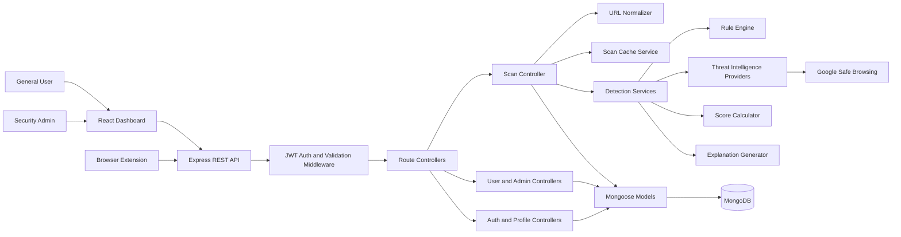
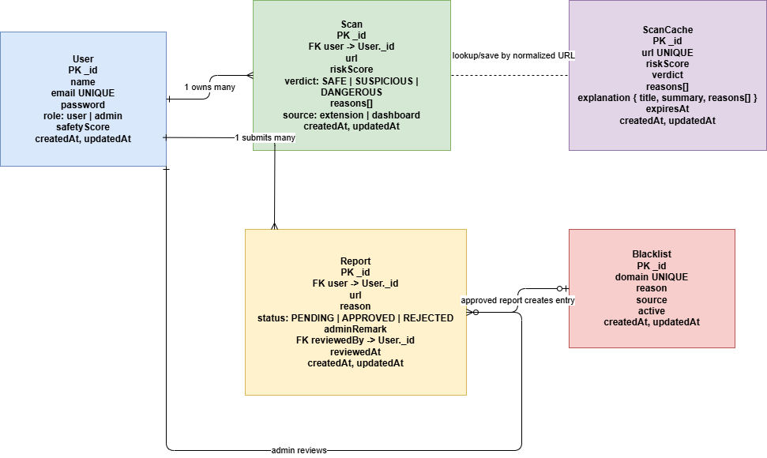
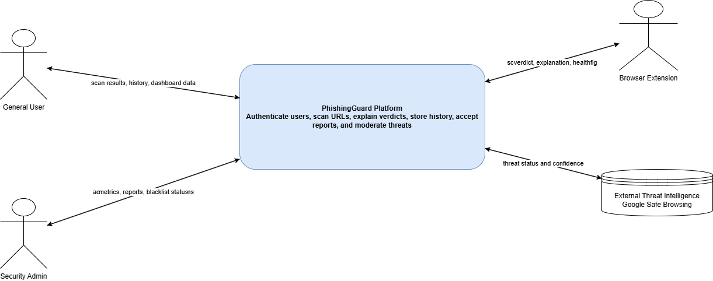
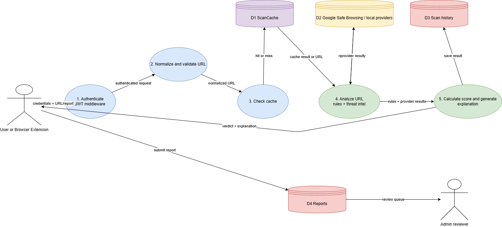
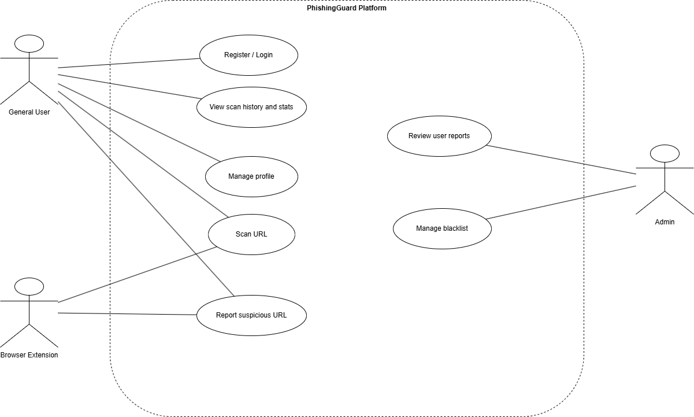
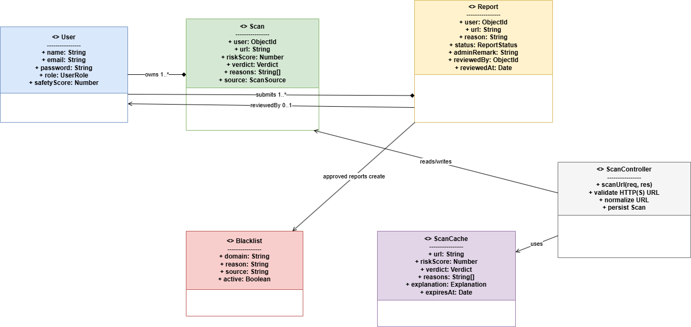
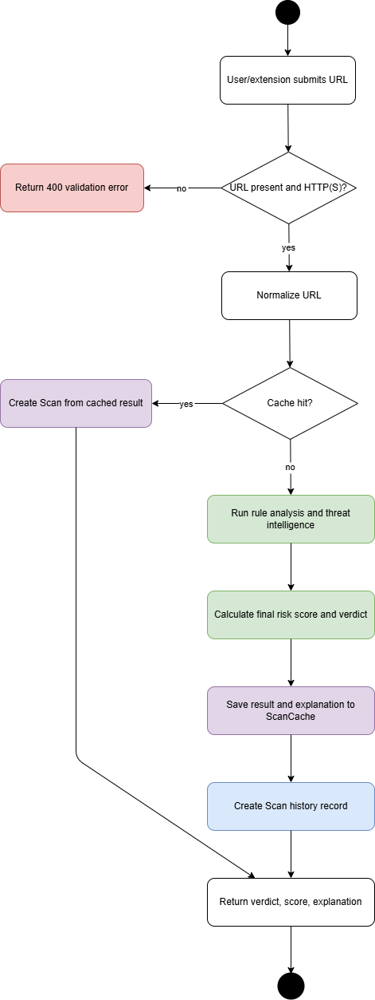
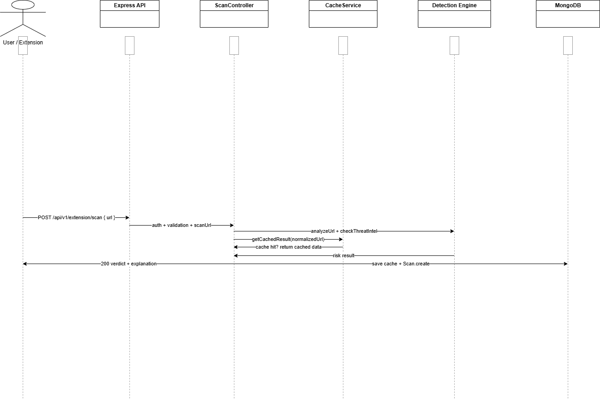
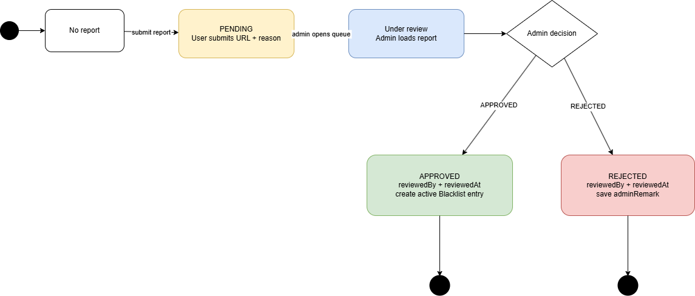

# 📄 Vision Document

## 🚀 Project Name & Overview

# PhishingGuard

**PhishingGuard** is an AI-powered phishing detection platform that protects users from malicious websites, emails, and URLs. It combines browser-based security, machine learning, threat intelligence, and explainable AI to detect phishing attempts in real time while maintaining user privacy.

The platform consists of:

- 🌐 Browser Extension
- ⚙️ Backend API
- 🤖 AI/ML Detection Engine
- 📊 Admin Dashboard
- 📈 Analytics & Reporting System

---

## ❗ Problem It Solves

Phishing attacks continue to be one of the leading causes of credential theft, financial fraud, and malware infections. Existing solutions often:

- Detect threats only after users visit malicious websites.
- Produce false positives without explanations.
- Depend solely on blacklists that fail against newly created phishing sites.
- Offer limited visibility into phishing trends and incidents.

PhishingGuard addresses these challenges by combining AI-based URL analysis, real-time detection, explainable results, and threat reporting to proactively protect users.

---

## 👥 Target Users (Personas)

### 🧑 General Internet Users

People who browse the web daily and need protection against phishing websites and malicious links.

### 👨‍💻 Students

Users who frequently receive emails and access educational portals, making them common phishing targets.

### 🏢 Organizations

Companies seeking to monitor phishing incidents, analyze threats, and improve employee cybersecurity awareness.

### 🔐 Security Analysts

Professionals who require dashboards, analytics, phishing reports, and threat intelligence for investigation.

---

## 🌟 Vision Statement

> To create an intelligent, privacy-first phishing detection platform that empowers users to browse the internet safely by providing fast, accurate, and explainable threat detection powered by artificial intelligence.

---

## 🎯 Key Features / Goals

### Browser Protection

- Real-time phishing website detection
- Instant browser warnings
- Safe browsing experience

### AI-Powered Detection

- Machine Learning based URL classification
- Heuristic analysis
- Explainable AI predictions

### Threat Intelligence

- URL reputation checking
- Blacklist and whitelist management
- Threat reporting

### Analytics Dashboard

- Detection statistics
- Threat trends
- User activity reports
- Security insights

### User Management

- Secure authentication
- Role-based access control
- Profile management

### Privacy & Security

- Minimal user data collection
- Secure API communication
- Encrypted sensitive information

---

## 📊 Success Metrics

The project will be considered successful if it achieves:

- 🎯 High phishing detection accuracy
- ⚡ Fast URL analysis and response time
- 📉 Low false-positive rate
- 👥 High user adoption
- 📈 Increased phishing reports detected
- 🔒 Secure handling of user data
- 😊 Positive user feedback and usability scores

---

## ⚠️ Assumptions & Constraints

### Assumptions

- Users have internet connectivity.
- The browser supports modern Web Extension APIs.
- AI models are trained on representative phishing datasets.
- Users install the browser extension.

### Constraints

- Zero-day phishing attacks may reduce detection accuracy.
- External threat intelligence APIs may have rate limits.
- Browser API permissions may limit certain detection features.
- Model performance depends on training data quality.
- Real-time detection must balance speed and accuracy.

---

## 🎯 Long-Term Vision

PhishingGuard aims to become a comprehensive cybersecurity platform by expanding beyond browser protection into:

- 📧 Email phishing detection
- 📱 Mobile application security
- 🌍 Enterprise threat monitoring
- ☁️ Cloud-based threat intelligence
- 🤖 Adaptive AI models with continuous learning
- 🔗 Integration with Security Information and Event Management (SIEM) platforms

## 🚀 Features

- **Real-Time URL Scanning**: Instantly analyzes URLs against Google Safe Browsing and custom rule-based detection engines.
- **Threat Intelligence**: Modular threat detection pipeline that caches results for optimized performance.
- **Interactive Dashboard**: View statistics, recent scans, and historical data with beautiful, animated charts.
- **User Authentication**: Secure signup and login flow powered by JWT and bcrypt.
- **Admin & Moderation Tools**: Built-in workflows for user reporting and managing URL blacklists.
- **Browser Extension Ready**: Integration APIs available for syncing browser extension data with the backend.

## 🛠️ Technology Stack

### Frontend

- **Framework**: React 19 + Vite
- **Styling**: Tailwind CSS v4 + Framer Motion (for animations)
- **UI Components**: shadcn/ui, Radix UI Primitives, Lucide Icons
- **Data Visualization**: Recharts
- **Routing**: React Router DOM

### Backend

- **Runtime**: Node.js
- **Framework**: Express.js
- **Database**: MongoDB (Mongoose)
- **Security**: Helmet, JSON Web Tokens (JWT)
- **Testing**: Jest & Supertest

### Infrastructure

- **Containerization**: Docker & Docker Compose

## Software Design

PhishingGuard uses a layered, modular architecture. The React dashboard and browser extension act as clients of the Express API. Authentication and validation middleware protect the API boundary, controllers coordinate use cases, detection services isolate URL analysis concerns, and Mongoose models provide the persistence boundary for MongoDB.

### High-Level Architecture



**Architecture style:** layered and service-oriented within a modular monolith. This keeps deployment simple while giving the detection pipeline, authentication, reporting, and persistence clear ownership boundaries. Controllers coordinate requests without embedding detection rules; detection services can therefore be tested or replaced independently, and external threat-intelligence providers remain behind a small integration boundary.

### Design Principles Applied

- **Abstraction:** Controllers depend on detection service functions such as URL analysis, threat-intelligence checks, score calculation, and explanation generation rather than implementing those algorithms directly.
- **Modularity:** Authentication, rate limiting, request validation, scanning, caching, reporting, blacklist management, and audit logging are separated into focused modules.
- **High cohesion:** Each service has one primary responsibility: `cacheService` manages cached results, the rule engine evaluates URL signals, and controllers handle API use cases.
- **Low coupling:** MongoDB access is isolated in Mongoose models, external reputation checks are isolated in providers, and the frontend communicates through API modules rather than directly accessing persistence.
- **Maintainability:** The cache-first scan path reduces repeated provider calls, while explicit verdict and report status values make behavior predictable and easier to extend.

### Editable Draw.io Diagrams

Open any source below in [diagrams.net](https://app.diagrams.net/) to inspect or edit it:

- [Entity Relationship Diagram](design/ERD.drawio)
- [Context Flow Diagram - Level 0](design/DFD-Context.drawio)
- [Data Flow Diagram - Level 1 Scan and Report](design/DFD-Level-1-Scan-Report.drawio)
- [Use Case Model](design/Use-Case-Model.drawio)
- [Class Model](design/Class-Model.drawio)
- [Activity Diagram - URL Scan](design/Activity-Diagram-Scan.drawio)
- [Sequence Diagram - URL Scan](design/Sequence-Diagram-Scan.drawio)
- [Statechart Diagram - Report Moderation](design/Statechart-Diagram.drawio)

### Diagram Previews

The PNG exports below provide quick previews of the current design diagrams. Click any preview to open its editable Draw.io source.

<details>
<summary>Entity Relationship Diagram</summary>

[](design/ERD.drawio)

</details>

<details>
<summary>Context Flow Diagram - Level 0</summary>

[](design/DFD-Context.drawio)

</details>

<details>
<summary>Data Flow Diagram - Level 1 Scan and Report</summary>

[](design/DFD-Level-1-Scan-Report.drawio)

</details>

<details>
<summary>Use Case Model</summary>

[](design/Use-Case-Model.drawio)

</details>

<details>
<summary>Class Model</summary>

[](design/Class-Model.drawio)

</details>

<details>
<summary>Activity Diagram - URL Scan</summary>

[](design/Activity-Diagram-Scan.drawio)

</details>

<details>
<summary>Sequence Diagram - URL Scan</summary>

[](design/Sequence-Diagram-Scan.drawio)

</details>

<details>
<summary>Statechart Diagram - Report Moderation</summary>

[](design/Statechart-Diagram.drawio)

</details>

The diagrams document the current implemented backend and frontend integration. Future capabilities such as email scanning, mobile clients, SIEM integration, and adaptive model training are intentionally excluded from the current design because they are part of the long-term vision rather than the present codebase.

## 📦 Getting Started

### Prerequisites

- [Docker](https://www.docker.com/) and [Docker Compose](https://docs.docker.com/compose/) installed on your machine.

### Installation & Setup

1. **Clone the repository:**

   ```bash
   git clone <repository-url>
   cd PhishingGuard-Extension
   ```
2. **Configure Environment Variables:**
   Navigate to the `backend/` directory and create a `.env` file based on `.env.example`:

   ```bash
   cd backend
   cp .env.example .env
   ```

   *Make sure to add your `GOOGLE_SAFE_BROWSING_API_KEY` and set a secure `JWT_SECRET`.*
3. **Run with Docker Compose:**
   From the root of the project, run:

   ```bash
   docker-compose up -d --build
   ```
4. **Access the Application:**

   - **Frontend:** http://localhost (Port 80)
   - **Backend API:** http://localhost:5000
   - **MongoDB:** mongodb://localhost:27017

## 👥 Contributions

| Area                     | Sanket                                                       | Mikhil                                               |
| :----------------------- | :----------------------------------------------------------- | :--------------------------------------------------- |
| **Frontend**       | React setup, UI components, dashboard, auth, & landing page. |                                                      |
| **Backend & APIs** |                                                              | Profile, history, admin dashboard, & extension APIs. |
| **Security**       |                                                              | Threat intel, Safe Browsing, & rule-based scanning.  |
| **DevOps**         | Docker setup, container networking, & app integration.       |                                                      |
| **Workflows**      |                                                              | Scan caching, reporting, moderation, & testing.      |
| **Documentation**  | Wrote project documentation.                                 |                                                      |
