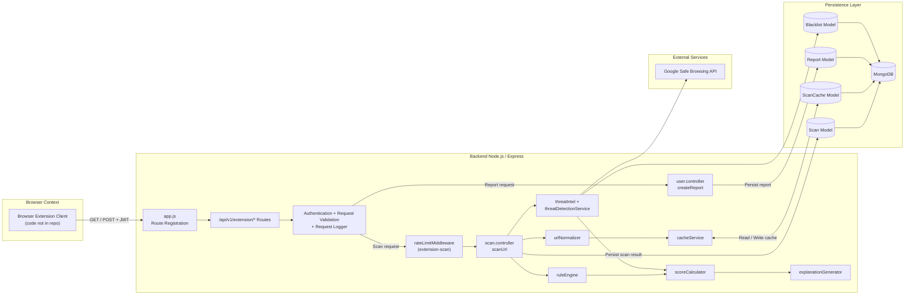

# PhishingGuard Extension Integration: System Design

## Purpose and scope
This document describes the **implemented architecture** in this repository for browser-extension phishing scanning integration.

Scope is limited to what exists in code today:
- backend extension-facing API endpoints and scan/report flow
- detection pipeline, persistence, and external threat-intel callouts
- runtime boundaries between a browser extension client and backend services

Out of scope:
- extension packaging/runtime internals (manifest, content scripts, popup/options pages), because those files are not present in this repository

## Current implementation boundaries
The repository contains backend integration points for an extension (`/api/v1/extension/*`) but does **not** currently contain extension runtime artifacts such as:
- `manifest.json`
- content scripts
- extension background/service worker scripts
- popup/options HTML/JS pages

Because of this, extension-side messaging/storage behavior is partially unknown and is marked as assumptions where needed.

## Entry points and key components
- Backend process entry: `backend/src/server.js`
- Express app wiring: `backend/src/app.js`
- Extension API routes: `backend/src/routes/extension.routes.js`
- Extension controller bridge: `backend/src/controllers/extension.controller.js`
- Scan/report logic used by extension routes:
  - `backend/src/controllers/scan.controller.js`
  - `backend/src/controllers/user.controller.js` (`createReport`)
- Auth/token handling: `backend/src/middleware/auth.js`
- Rate limiting (extension scan): `backend/src/middleware/rateLimiter.js`
- Detection pipeline:
  - Heuristics: `backend/src/services/detection/ruleEngine.js`
  - Threat intel orchestration: `backend/src/services/detection/threatIntel.js`
  - Providers:
    - local blacklist: `backend/src/services/detection/providers/localBlacklist.provider.js`
    - Google Safe Browsing: `backend/src/services/detection/providers/googleSafeBrowsing.provider.js`
  - Score merge: `backend/src/services/detection/scoreCalculator.js`
  - Explanation generation: `backend/src/services/detection/explanationGenerator.js`
  - URL normalization: `backend/src/utils/urlNormalizer.js`
  - Cache service: `backend/src/services/detection/cacheService.js`

## Runtime contexts
### 1) Browser extension context (external client; code not present here)
Expected behavior from implemented backend contract:
- authenticate with JWT via either an Authorization bearer token or the `x-extension-token` header
- call:
  - `GET /api/v1/extension/health`
  - `GET /api/v1/extension/config`
  - `POST /api/v1/extension/scan`
  - `POST /api/v1/extension/report`

### 2) Backend API context (implemented)
Express app exposes versioned routes, applies middleware (auth, validation, request logging, rate limiting), executes scan/report controllers, and returns verdict + explanation payloads.

### 3) Persistence context (implemented)
MongoDB (Mongoose models) stores:
- scan history (`Scan`)
- cached scan outcomes with expiry (`ScanCache`)
- user reports (`Report`)
- local blacklist entries (`Blacklist`)

### 4) External service context (implemented)
Google Safe Browsing API is called by provider logic when `GOOGLE_SAFE_BROWSING_API_KEY` is configured.

## High-level data flow
1. Extension sends URL scan request to `/api/v1/extension/scan`.
2. Backend validates JWT, validates URL, and rate-limits requests.
3. URL is normalized and checked against `ScanCache`.
4. On cache miss, backend runs heuristic rule engine + threat intel checks.
5. Final score/verdict is produced; explanation is generated.
6. Result is cached (24h TTL in current implementation) and scan record is persisted.
7. Response returns URL verdict and explanation to extension.
8. Report submission path (`/api/v1/extension/report`) writes a `Report` record (deduping pending report per user+URL).

## Component diagram (Mermaid)

## Security and privacy considerations
Observed in current implementation:
- JWT-based auth for protected extension endpoints (`auth.js`)
- per-IP, in-memory rate limiting for extension scan endpoint
- input validation for URL/report payloads on extension routes
- backend-side URL normalization + bounded scoring output
- request logs include user id and endpoint metadata for extension requests

Important caveats:
- rate limiter is in-memory and process-local (not distributed/shared)
- provider failures/timeouts default to safe result in threat intel path (availability-first behavior)
- no extension-side local storage model is visible in this repo
- privacy handling in extension runtime (what URL metadata is retained client-side) is not verifiable from this repository

## Assumptions and limitations
- The browser extension runtime implementation exists outside this repository or is not yet committed.
- No `chrome.runtime`/`browser.runtime` message bus behavior can be documented from current code.
- No manifest permissions can be audited from current code because `manifest.json` is absent.
- Design here reflects backend contracts and runtime behavior only, plus extension-client assumptions derived from those contracts.
